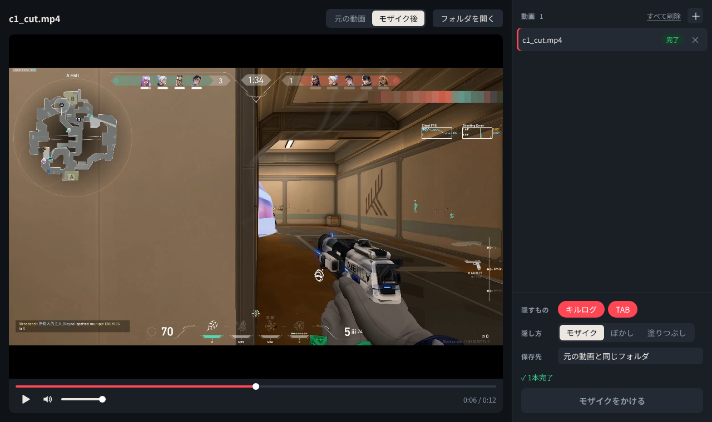

# Edirantor

VALORANT のクリップを編集して、キルログとスコアボード（TAB）に自動でモザイクをかけて書き出せる、Windows 用の無料動画エディタです。

## ダウンロード

**[最新版を入手（Releases）](https://github.com/parbon333/Edirantor/releases/latest)**

`Edirantor.exe` をダウンロードして、ダブルクリックで起動します。インストールは不要です。

> 「Windows によって PC が保護されました」と出たら「詳細情報」→「実行」を押してください。

## できること

- カット・結合・複数トラック（映像3本・音声3本）の編集
- キルログ・TAB の自動モザイク（書き出し時）
- 自分のキルの自動検出、タイムラインへのマーカー、キル前後の自動切り出し
- モーションブラー（動画全体）
- 映像のフェードイン・フェードアウト・クロスフェード（音声も連動）
- 音量の dB 調整（最大 +20 dB）
- 日本語／English

## 使い方

1. 「新規プロジェクト」でプロジェクトファイル（`.edir`）の保存先を決める
2. 動画をウィンドウにドラッグ＆ドロップ
3. タイムラインで必要なところを残す
4. 「書き出し」を押す

## 対応している録画

- 16:9（1920×1080 など）で、HUD の位置が標準のまま
- 通常の試合・デスマッチのスコアボード

## 動作環境

Windows 10 / 11（64bit）

## 不具合・要望

[Issues](https://github.com/parbon333/Edirantor/issues) へどうぞ。

## ライセンス

利用条件は [LICENSE.txt](LICENSE.txt)、同梱ソフトウェアは [THIRD-PARTY-NOTICES.md](THIRD-PARTY-NOTICES.md) を参照してください。

Edirantor is a free Windows video editor for VALORANT clips that automatically mosaics the kill feed and scoreboard on export. Download `Edirantor.exe` from Releases.

---

Edirantor は Riot Games と無関係の非公式ツールです。VALORANT は Riot Games, Inc. の商標です。
